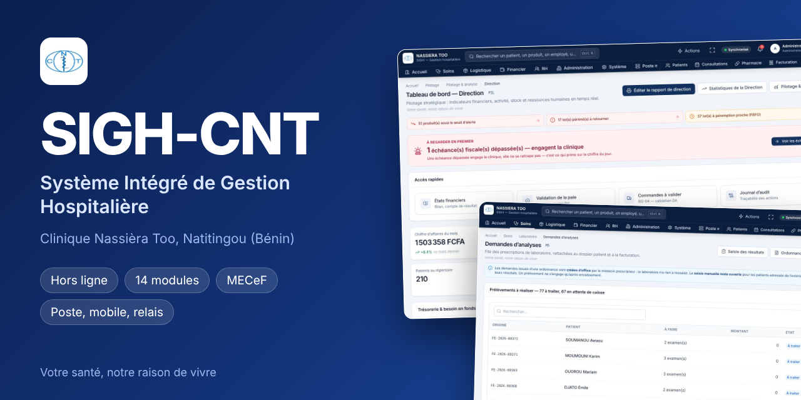
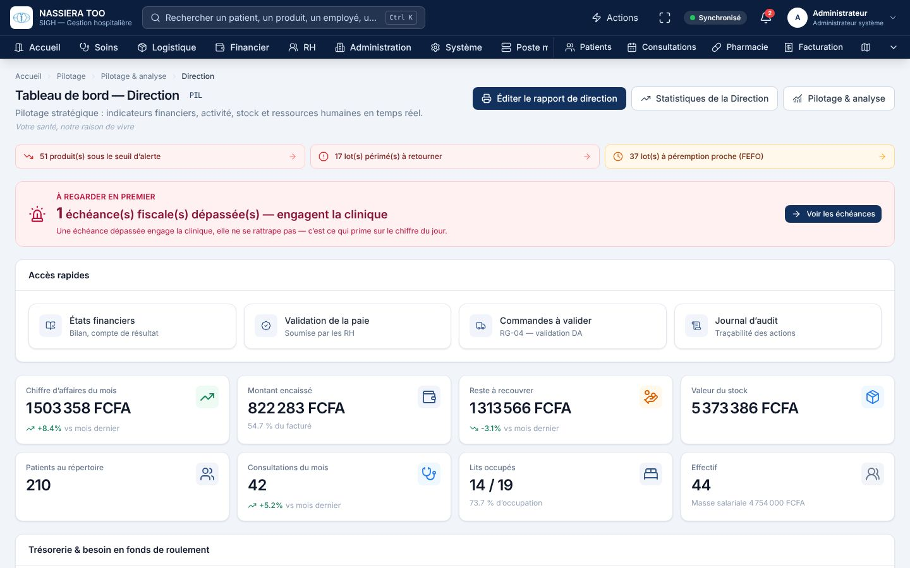
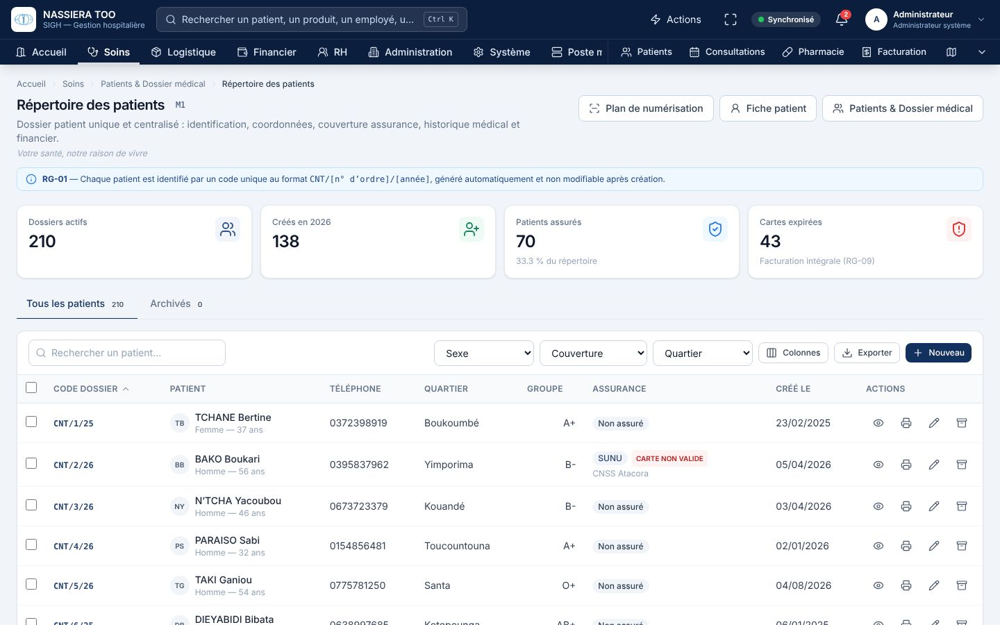
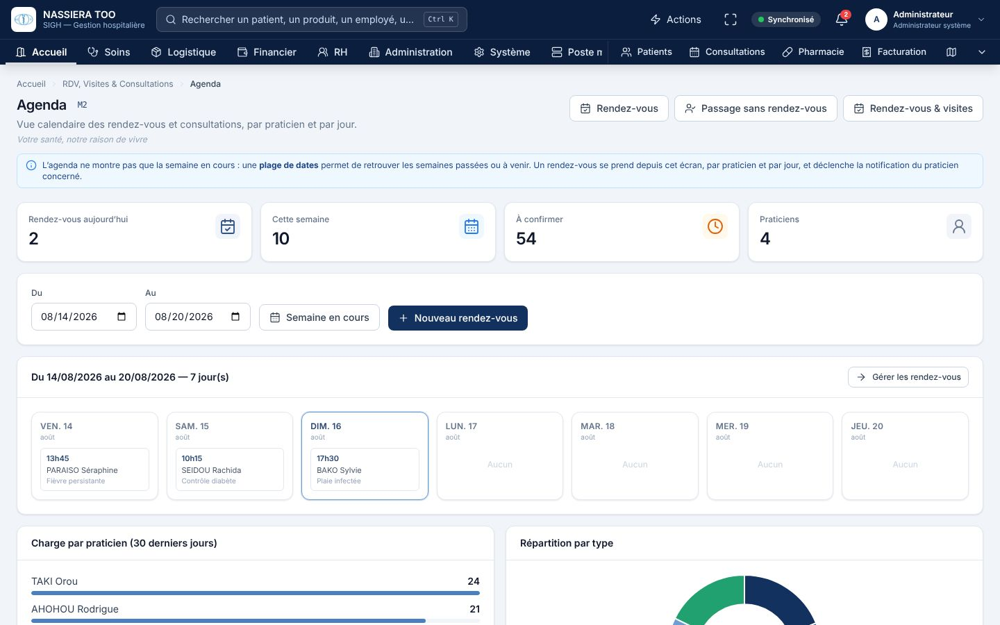
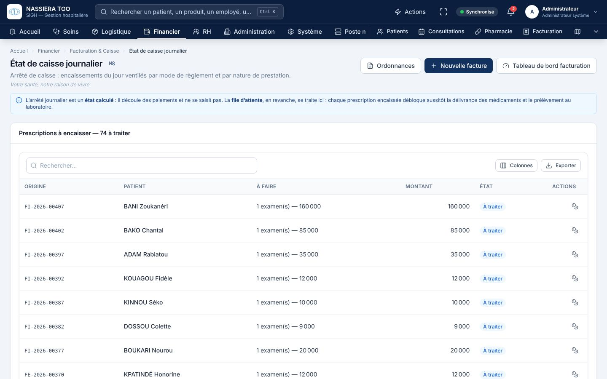
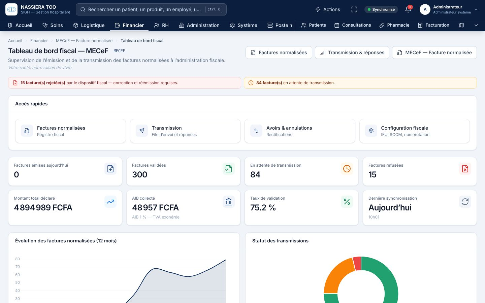
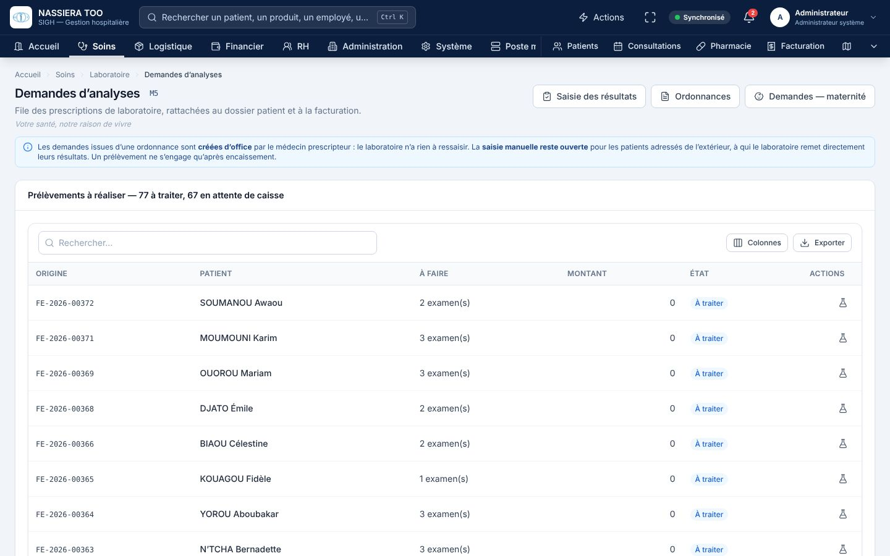
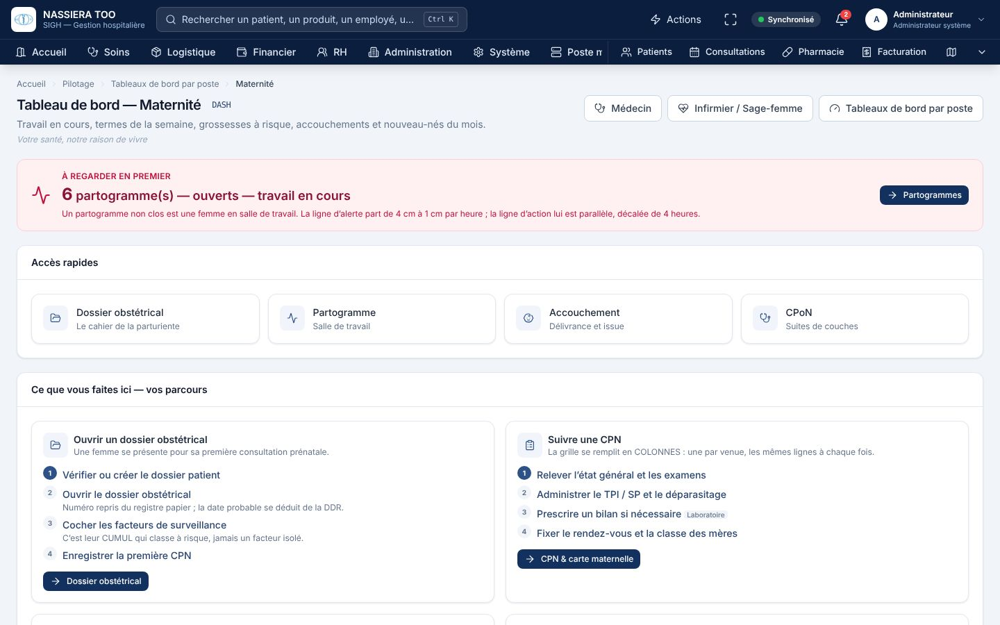
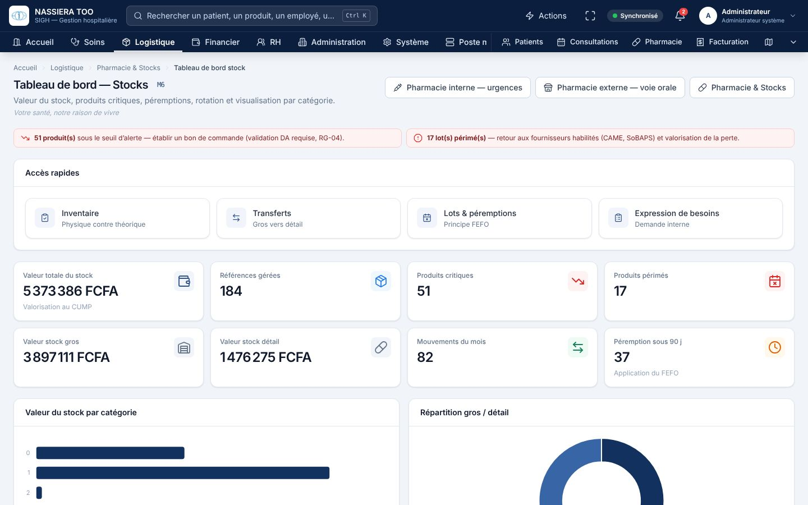
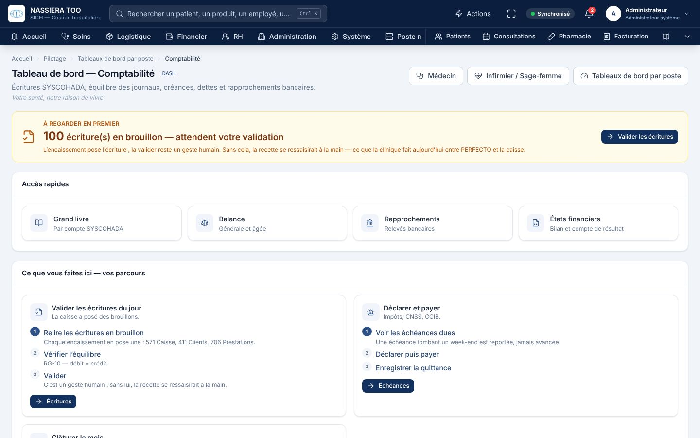

# SIGH-CNT

**Système Intégré de Gestion Hospitalière** pour la Clinique Nassièra Too, Natitingou (Bénin)

*Un seul logiciel pour suivre le patient de l'accueil à la comptabilité, même sans connexion.*

---

## Le projet

SIGH-CNT est un logiciel de gestion de clinique conçu pour une structure d'environ 30 agents et 18 000 dossiers patients, qui travaillait avec un parc d'outils séparés (stock, laboratoire, comptabilité, dossiers médicaux) et beaucoup de papier.

Il réunit tout dans **un seul parcours** : consultation, prescription, caisse, laboratoire, résultat, dossier du patient, écriture comptable, sans ressaisie d'un poste à l'autre.

Trois choix le caractérisent :

- **Il continue de fonctionner sans internet.** Chaque poste est autonome ; la synchronisation entre les postes se rattrape ensuite.
- **Il cloisonne les données.** Seize rôles, chacun ne voit que ce que son métier exige : le médical est réservé au soignant habilité, le financier et les RH aux profils concernés.
- **Il ne supprime jamais.** Un élément se retire en l'archivant, et chaque action est journalisée au nom de son auteur.

## Fonctionnalités principales

Quatorze modules couvrent l'activité de la clinique : patients et dossier médical, rendez-vous et consultations, hospitalisation, maternité, laboratoire et banque de sang, pharmacie et stocks, achats, facturation et caisse, assurances, ressources humaines, paie et primes, comptabilité SYSCOHADA, administration, sécurité.

### Un tableau de bord pour chaque métier

Chaque profil arrive sur une page qui lui dit **ce qu'il doit regarder en premier** : échéances fiscales en retard pour la Direction, partogrammes ouverts pour la sage-femme, prescriptions à encaisser pour la caisse.

### Dossier patient unique

Un code unique par patient, la couverture d'assurance et sa validité visibles dès l'ouverture, l'historique médical et financier réuni.

### Agenda, rendez-vous et consultations

### Caisse et facturation

Les prescriptions encaissées débloquent aussitôt la délivrance des médicaments et le prélèvement au laboratoire. La part de l'assureur, la part du patient et les remises sont calculées ligne par ligne.

### Facturation normalisée MECeF

Toute vente est normalisée, avec suivi des factures transmises, en attente ou refusées.

### Laboratoire

De la prescription au compte rendu : prélèvement après encaissement, saisie des résultats, validation technique puis biologique.

### Maternité

Dossier obstétrical, consultations prénatales, partogramme, accouchement, nouveau-né et suites de couches.

### Pharmacie et stocks

Alertes de seuil et de péremption (premier périmé, premier sorti), mouvements rattachés à un justificatif, stock jamais négatif.

### Comptabilité

Écritures équilibrées, journaux, grand livre, balance, bilan et compte de résultat au format de la liasse, clôture d'exercice.

### Et aussi

Paie et primes de garde, gestion du personnel et des plannings, assurances et créances, achats et fournisseurs, administration et courriers, impression de tous les états avec l'en-tête officiel (facture, bulletin, ordonnance, résultat, rapport), application mobile pour les soignants, site public de la clinique.

Captures de la version de démonstration. Toutes les données affichées sont fictives.

## État du projet

Projet en développement actif. Une maquette complète sert de référence, et l'application de poste, l'application mobile et le service de synchronisation en ligne sont construits à partir d'elle.

## Contact

Pour un **usage commercial**, une démonstration ou toute demande de licence :

**rarhodes06@gmail.com**

## Licence

Tous droits réservés. Ce dépôt est privé et son contenu ne peut être copié, modifié, distribué ni utilisé, notamment à des fins commerciales, sans autorisation écrite préalable.
