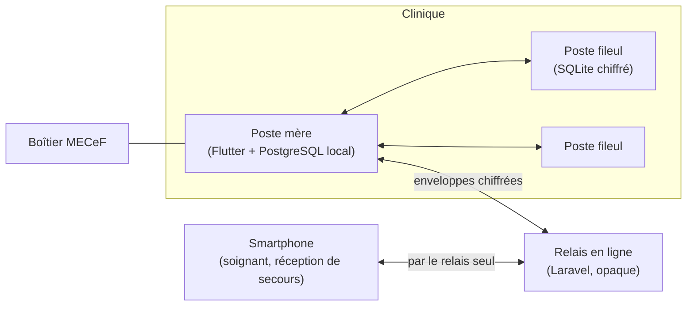

<div align="center">

# SIGH-CNT

**Système Intégré de Gestion Hospitalière**
de la **Clinique Nassièra Too SARL**, Natitingou (Bénin)

*Votre santé, notre raison de vivre*


</div>

---

## En bref

Une clinique d'environ **30 agents** et **18 000 dossiers patients** travaillait avec un parc cloisonné : un logiciel de stock, un cahier de laboratoire, un logiciel de comptabilité, un dossier médical, et beaucoup de papier. SIGH-CNT remplace cet ensemble par **un seul logiciel**, qui suit le patient de l'accueil à la comptabilité :

> consultation, prescription, caisse, laboratoire, résultat, dossier, écriture comptable

Il couvre **14 modules** (patients, rendez-vous et consultations, hospitalisation, maternité, laboratoire, pharmacie et stocks, achats, facturation et caisse, assurances, RH, paie, comptabilité SYSCOHADA, administration, sécurité), la **facturation normalisée MECeF**, l'impression des états officiels et **16 rôles** aux droits cloisonnés.

Le critère de réussite n'est pas le nombre d'écrans : c'est qu'un parcours **traverse les modules de bout en bout** sans ressaisie.

## Trois idées qui structurent tout

| Idée | Ce que cela veut dire |
|---|---|
| **Hors ligne d'abord** | Chaque poste travaille seul, même coupé du réseau. La synchronisation est un détail qui se rattrape, pas une condition pour soigner. |
| **Une source, jamais deux** | Droits, navigation, couleurs, règles chiffrées : chacun vit dans un fichier unique, engendré, que tous les consommateurs relisent. |
| **Extraire, ne pas deviner** | La maquette est l'exécutable de référence. On en tire des vecteurs de test, on les rejoue sur le code Dart, et une règle sans vecteur n'est pas portée. |

## Architecture



- **Postes** : application Flutter pour Windows et Linux, modes **fileul** et **mère**. La mère garde l'autorité de la clinique ; les fileuls restent utilisables sans elle.
- **Synchronisation** par **journal d'opérations** : l'état est le pli d'opérations uniques ; chaque famille de données a sa règle de fusion (compteurs par variations, numéros jamais réécrits, lits en conflit marqués).
- **Relais en ligne** : un serveur sur hébergement mutualisé qui **ne lit jamais un dossier**. Il transporte des enveloppes chiffrées de bout en bout, la clé restant dans la clinique.
- **Règles de gestion** écrites **une seule fois**, en Dart, et exécutées au poste, au mobile et à la mère. Le relais n'en contient aucune.
- **Mobile** : deux profils minimaux (soignant, réception de secours), uniquement par le relais.

Détail : [`docs/architecture/ARCHITECTURE-CIBLE.md`](docs/architecture/ARCHITECTURE-CIBLE.md) et les [décisions d'architecture](docs/architecture/adr/).

## Carte du dépôt

| Dossier | Rôle |
|---|---|
| [`prototype_html/`](prototype_html/) | **Maquette de référence** : 359 pages, moteurs métier, base PostgreSQL, bancs d'essai de bout en bout. Hors espaces de travail npm, avec son outillage propre. |
| [`apps/poste/`](apps/poste/) | **Poste de travail** Flutter (fileul et mère), installateur Windows, écrans portés avec mesure de parité. |
| [`apps/mobile/`](apps/mobile/) | Application Flutter minimale pour les smartphones. |
| [`apps/web/`](apps/web/) | **Relais en ligne** et panneau superadmin (Laravel 12). |
| [`apps/vitrine/`](apps/vitrine/) | Site public de la clinique. Ne se supprime en aucun cas. |
| [`apps/hub/`](apps/hub/) | Retiré du plan : son rôle est tenu par le poste mère. |
| [`packages/domaine/`](packages/domaine/) | Règles de gestion en **Dart pur**, rejouées sur des vecteurs tirés de la maquette. |
| [`packages/sync/`](packages/sync/) et [`packages/sync_dart/`](packages/sync_dart/) | Protocole de synchronisation et son banc de référence (processus réels, réseau coupé). |
| [`packages/rbac/`](packages/rbac/) | Matrice des droits : une source, plusieurs consommateurs. |
| [`packages/referentiels/`](packages/referentiels/) | Documents de cadrage devenus référentiels versionnés. |
| [`packages/schema/`](packages/schema/) | Schéma relationnel (139 tables, 18 schémas de module). |
| [`packages/impression/`](packages/impression/) | Gabarits A4, rouleau 80 mm, carte CR80, en-tête légal unique. |
| [`infra/`](infra/) | Installation, sauvegardes, reprise. |
| [`docs/`](docs/README.md) | PRD, plans, spécifications, ADR, écarts, documents de cadrage. |

## Règles qui ne se contournent pas

Quelques invariants traversent tous les modules (liste complète dans [`CLAUDE.md`](CLAUDE.md)) :

- **RG-02** : les médicaments se facturent au prix d'achat, sans marge.
- **RG-03** : le stock ne devient jamais négatif ; toute sortie a un justificatif.
- **RG-09** : la prise en charge de l'assurance ne vaut que si la carte est valide **à la date** de facturation.
- **RG-10** : toute écriture comptable est équilibrée avant validation.
- **RG-12** : aucune action anonyme, tout est journalisé.
- **RG-13** : médical réservé au soignant habilité, financier et RH aux profils concernés.
- **RG-14** : on archive, on ne supprime jamais.

Et trois habitudes de conception : un **refus se nomme** (code, motif, geste de correction), une **commande interdite est absente** plutôt que grisée, et **« non calculable » n'est pas zéro**.

## Démarrer

```bash
npm install                 # espaces de travail apps/* et packages/*
npm run prototype:install   # outillage de la maquette
service postgresql start    # la maquette garde ses données en PostgreSQL
npm run prototype:serveur   # la maquette avec sa base (port 8080)
npm run prototype:verify    # lint, build, contrôle des pages, parcours de bout en bout
```

Pour le poste et les paquets Dart : `dart test` dans `packages/domaine`, `flutter analyze && flutter test` dans `apps/poste`. Pas à pas complet : [`docs/guides/GUIDE-DEMARRAGE.md`](docs/guides/GUIDE-DEMARRAGE.md).

## Qualité mesurée

Chiffres relevés au 09/11/2026, jamais déclarés d'office :

| Contrôle | Résultat |
|---|---|
| Parcours fonctionnels de la maquette | **97 scénarios, 1 711 vérifications**, tous conformes |
| Audit des droits (chaque écran sous chaque profil) | **0 promesse** sur environ 1 340 sondages |
| Domaine Dart | **2 890 tests**, tous passés |
| Poste Flutter | **2 334 tests**, tous passés |
| Parité écran par écran avec la maquette | mesurée, un statut « porté » est refusé sous 100 % |

## Ce qui n'est pas fait, et que le dépôt dit

Un rapport qui cache ses limites est faux. À ce jour :

- Aucun envoi **SMS** ni aucune **normalisation fiscale** n'a été éprouvé contre un vrai fournisseur ou un vrai boîtier : seuls des simulateurs ont tourné.
- Les **tarifs d'attente**, bornes de laboratoire et listes proposées sont **marqués à valider** par le professionnel ou la Direction concernés ; rien n'est inventé pour combler un vide.
- Le poste n'a pas été compilé en natif dans l'environnement de rédaction, et la recette sur site reste à faire.
- Les écarts connus entre maquette et poste sont tenus dans [`docs/architecture/ECARTS-MAQUETTE.md`](docs/architecture/ECARTS-MAQUETTE.md).

## Documentation

| Pour | Lire |
|---|---|
| Tout voir d'un coup | [`docs/README.md`](docs/README.md) |
| Doctrine, règles de gestion, pièges | [`CLAUDE.md`](CLAUDE.md) |
| Cible et décisions | [`docs/architecture/`](docs/architecture/) |
| Exigences et plans | [`docs/prd/`](docs/prd/) et [`docs/plans/`](docs/plans/) |
| Protocole de synchronisation | [`docs/specs/SPEC-protocole-synchronisation.md`](docs/specs/SPEC-protocole-synchronisation.md) |
| Panne de connexion | [`docs/guides/PANNE-DE-CONNEXION.md`](docs/guides/PANNE-DE-CONNEXION.md) |

## Cycle de travail

Le dossier `.claude/skills/` encadre le cycle : `/prd`, `/adr`, `/spec`, `/plan`, `/test-plan`, `/review`, `/release`. Chaque skill écrit dans `docs/` au gabarit fourni. Un agent de suivi (`.claude/agents/suivi-lots.md`) relit l'avancement d'un plan sans rien modifier.

## Secrets

Aucun identifiant ne se versionne : `.env`, `*.local.php` et les exports `*.sql` sont ignorés. Les mots de passe des fournisseurs (messagerie, SMS) se saisissent dans le panneau d'administration, en écriture seule, chiffrés, jamais relus. Copier `prototype_html/api/config.local.exemple.php` vers `config.local.php` sur chaque poste de développement.

## Licence

Dépôt **privé**, tous droits réservés (`UNLICENSED`). Propriété de la Clinique Nassièra Too SARL.
