# Diagramme entité-relation

> **ENGENDRÉ** par `prototype_html/build/gen-erd.js` depuis `packages/schema/postgres/` — ne pas éditer. Dictionnaire des colonnes : [`DICTIONNAIRE-DONNEES.md`](DICTIONNAIRE-DONNEES.md).
> Ne figurent que les relations **déclarées** au schéma (71 clés étrangères sur 139 tables, 18 schémas). Les liens que le jeu courant ne respecte pas à 100 % ne sont pas déclarés (ils bloqueraient l'écriture) : la cible, avec un seul chemin d'écriture ordonné, les appliquera.

| Mesure | Valeur |
|---|---|
| Tables | 139 |
| Schémas (un par module) | 18 |
| Clés étrangères déclarées | 71 (dont 16 tables filles, 55 entre collections) |

## Transversal — liens entre modules

### Collections qui référencent d'autres collections

```mermaid
erDiagram
  m1_patients ||--o{ m4_accouchements : "patient_id"
  m1_patients ||--o{ m3_administrations : "patient_id"
  m2_prescriptions ||--o{ m3_administrations : "prescription_id"
  m1_patients ||--o{ m3_admissions : "patient_id"
  m1_patients ||--o{ m13_ambulance : "patient_id"
  m1_patients ||--o{ m3_checklists_bloc : "patient_id"
  m1_patients ||--o{ m2_consultations : "patient_id"
  m1_patients ||--o{ m4_cpon : "patient_id"
  m1_patients ||--o{ m4_cr_maternite : "patient_id"
  m1_patients ||--o{ m3_cr_operatoires : "patient_id"
  m1_patients ||--o{ m4_deces : "patient_id"
  m1_patients ||--o{ m5_demandes_analyses : "patient_id"
  m2_ordonnances ||--o{ m5_demandes_analyses : "ordonnance_id"
  m8_factures ||--o{ m5_demandes_analyses : "facture_id"
  m8_factures ||--o{ m2_demandes_imagerie : "facture_id"
  m1_patients ||--o{ m2_demandes_imagerie : "patient_id"
  m1_patients ||--o{ m2_dossiers_consultation : "patient_id"
  m1_patients ||--o{ m4_dossiers_obstetricaux : "patient_id"
  m1_patients ||--o{ m8_factures : "patient_id"
  m10_personnel ||--o{ m8_factures : "personnel_id"
  m2_ordonnances ||--o{ m8_factures : "ordonnance_id"
  m1_patients ||--o{ m2_file_attente : "patient_id"
  m1_patients ||--o{ m4_grossesses : "patient_id"
  m1_patients ||--o{ m14_notifications : "patient_id"
  m8_factures ||--o{ m2_ordonnances : "facture_id"
  m1_patients ||--o{ m2_ordonnances : "patient_id"
  m1_patients ||--o{ m4_partogrammes : "patient_id"
  m9_souscripteurs ||--o{ m1_patients : "souscripteur_id"
  m10_personnel ||--o{ m1_patients : "personnel_id"
  m1_patients ||--o{ m4_planification_familiale : "patient_id"
  m1_patients ||--o{ m2_prescriptions : "patient_id"
  m1_patients ||--o{ m4_ptme : "patient_id"
  m1_patients ||--o{ m3_rapports_medicaux : "patient_id"
  m1_patients ||--o{ m4_registre_sonu : "patient_id"
  m1_patients ||--o{ m2_resultats_imagerie : "patient_id"
  m1_patients ||--o{ m3_scores_glasgow : "patient_id"
  m10_personnel ||--o{ m14_soignants : "personnel_id"
  m1_patients ||--o{ m2_soins : "patient_id"
  m3_admissions ||--o{ m2_soins : "admission_id"
  m1_patients ||--o{ m4_soins_curatifs_maternite : "patient_id"
  m1_patients ||--o{ m4_suivi_maternite : "patient_id"
  m1_patients ||--o{ m3_surveillances_transfusion : "patient_id"
  m8_factures ||--o{ socle_taches : "facture_id"
  m2_ordonnances ||--o{ socle_taches : "ordonnance_id"
  m1_patients ||--o{ socle_taches : "patient_id"
```

Tables : `m1.patients` (40 col.) · `m10.personnel` (17 col.) · `m13.ambulance` (18 col.) · `m14.notifications` (18 col.) · `m14.soignants` (13 col.) · `m2.consultations` (31 col.) · `m2.demandes_imagerie` (31 col.) · `m2.dossiers_consultation` (52 col.) · `m2.file_attente` (18 col.) · `m2.ordonnances` (31 col.) · `m2.prescriptions` (25 col.) · `m2.resultats_imagerie` (30 col.) · `m2.soins` (18 col.) · `m3.administrations` (22 col.) · `m3.admissions` (19 col.) · `m3.checklists_bloc` (14 col.) · `m3.cr_operatoires` (21 col.) · `m3.rapports_medicaux` (28 col.) · `m3.scores_glasgow` (14 col.) · `m3.surveillances_transfusion` (21 col.) · `m4.accouchements` (26 col.) · `m4.cpon` (18 col.) · `m4.cr_maternite` (42 col.) · `m4.deces` (12 col.) · `m4.dossiers_obstetricaux` (44 col.) · `m4.grossesses` (19 col.) · `m4.partogrammes` (16 col.) · `m4.planification_familiale` (16 col.) · `m4.ptme` (22 col.) · `m4.registre_sonu` (19 col.) · `m4.soins_curatifs_maternite` (18 col.) · `m4.suivi_maternite` (17 col.) · `m5.demandes_analyses` (57 col.) · `m8.factures` (40 col.) · `m9.souscripteurs` (17 col.) · `socle.taches` (29 col.)

## Par module

### cfg — Configuration

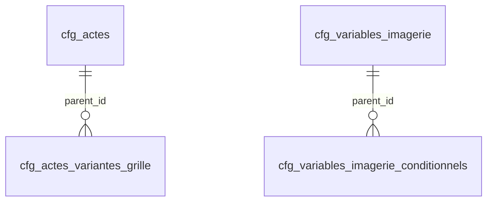

Tables : `cfg.actes` (17 col.) · `cfg.actes_variantes_grille` (19 col.) · `cfg.variables_imagerie` (14 col.) · `cfg.variables_imagerie_conditionnels` (6 col.)

### ged — GED

Aucune relation déclarée.

### m1 — M1 Patients & DMI

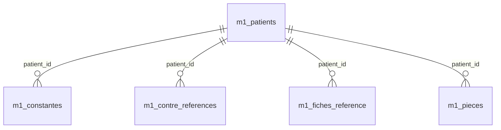

Tables : `m1.constantes` (24 col.) · `m1.contre_references` (26 col.) · `m1.fiches_reference` (36 col.) · `m1.patients` (40 col.) · `m1.pieces` (21 col.)

### m2 — M2 RDV, visites, consultations, imagerie

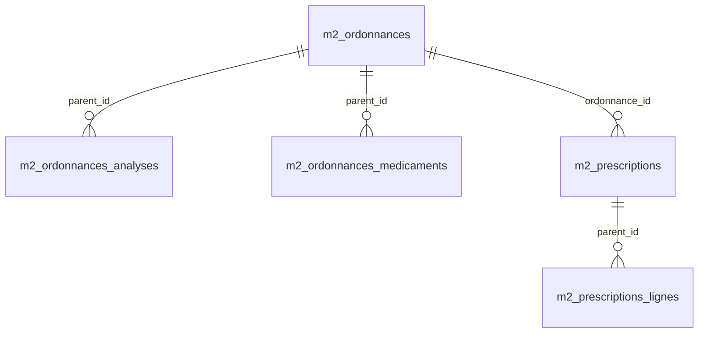

Tables : `m2.ordonnances` (31 col.) · `m2.ordonnances_analyses` (9 col.) · `m2.ordonnances_medicaments` (11 col.) · `m2.prescriptions` (25 col.) · `m2.prescriptions_lignes` (16 col.)

### m3 — M3 Hospitalisation & bloc

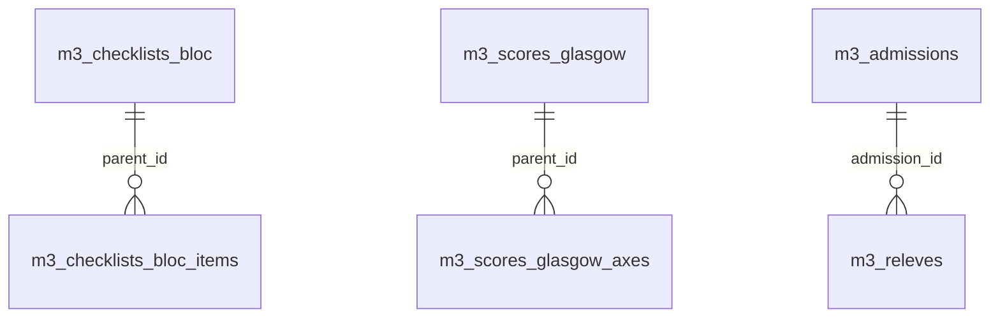

Tables : `m3.admissions` (19 col.) · `m3.checklists_bloc` (14 col.) · `m3.checklists_bloc_items` (5 col.) · `m3.releves` (16 col.) · `m3.scores_glasgow` (14 col.) · `m3.scores_glasgow_axes` (6 col.)

### m4 — M4 Maternité, naissances, décès

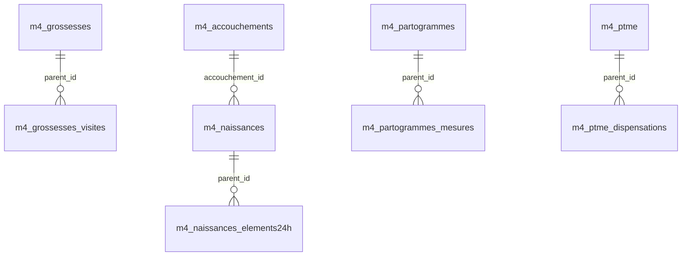

Tables : `m4.accouchements` (26 col.) · `m4.grossesses` (19 col.) · `m4.grossesses_visites` (47 col.) · `m4.naissances` (27 col.) · `m4.naissances_elements24h` (13 col.) · `m4.partogrammes` (16 col.) · `m4.partogrammes_mesures` (17 col.) · `m4.ptme` (22 col.) · `m4.ptme_dispensations` (5 col.)

### m5 — M5 Laboratoire

Aucune relation déclarée.

### m6 — M6 Pharmacie & stocks

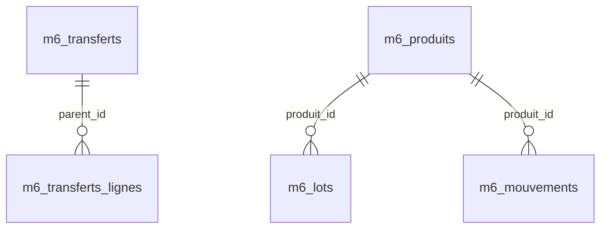

Tables : `m6.lots` (9 col.) · `m6.mouvements` (15 col.) · `m6.produits` (25 col.) · `m6.transferts` (19 col.) · `m6.transferts_lignes` (12 col.)

### m7 — M7 Achats & fournisseurs

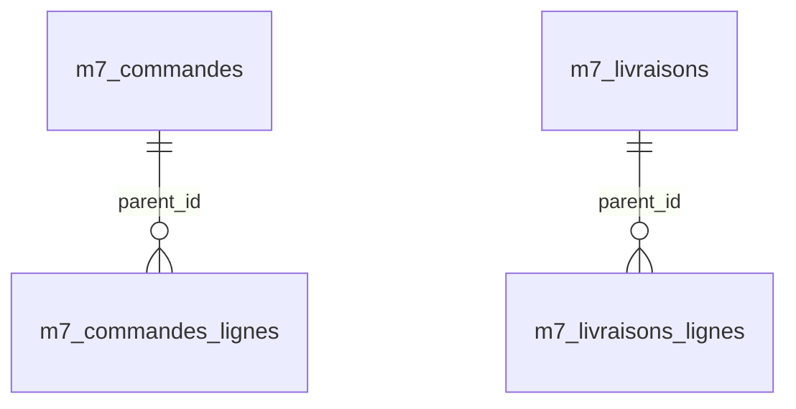

Tables : `m7.commandes` (12 col.) · `m7.commandes_lignes` (9 col.) · `m7.livraisons` (11 col.) · `m7.livraisons_lignes` (11 col.)

### m8 — M8 Facturation & caisse

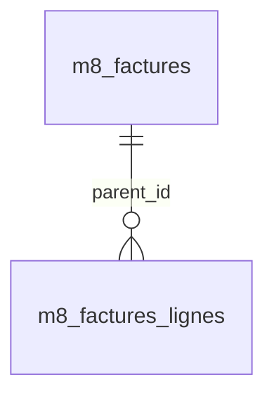

Tables : `m8.factures` (40 col.) · `m8.factures_lignes` (25 col.)

### m9 — M9 Assurances & créances

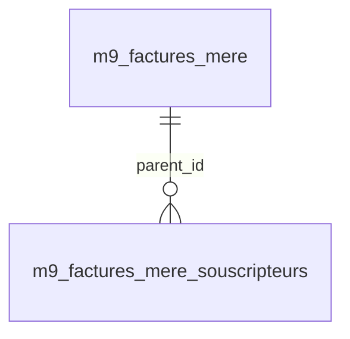

Tables : `m9.factures_mere` (24 col.) · `m9.factures_mere_souscripteurs` (8 col.)

### m10 — M10 Ressources humaines

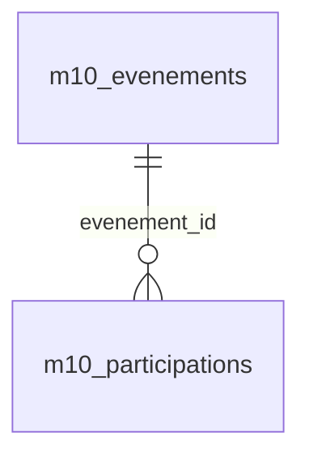

Tables : `m10.evenements` (15 col.) · `m10.participations` (16 col.)

### m11 — M11 Paie & primes

Aucune relation déclarée.

### m12 — M12 Comptabilité SYSCOHADA

Aucune relation déclarée.

### m13 — M13 Administration & ambulance

Aucune relation déclarée.

### m14 — M14 Sécurité & audit

Aucune relation déclarée.

### socle — Socle commun (référentiels lus par plusieurs modules)

Aucune relation déclarée.

### sup — Support

Aucune relation déclarée.

## Tables sans aucune relation déclarée

70 tables sur 139 : ce sont des registres autonomes (référentiels, journaux, pièces émises) ou des collections dont les liens ne sont pas encore garantis.

Liste

- `cfg.catalogue_tarifs`
- `cfg.certificats`
- `cfg.examens_imagerie`
- `cfg.modeles_message`
- `cfg.modules_actifs`
- `cfg.natures_facture`
- `cfg.postes`
- `cfg.rappels`
- `cfg.secteurs`
- `cfg.types_piece`
- `ged.documents`
- `m1.documents_patient`
- `m10.assurances_personnel`
- `m10.badges`
- `m10.bareme_ns131`
- `m10.evaluations`
- `m10.fiches_poste`
- `m10.grille_primes`
- `m10.historique_bareme`
- `m10.historique_primes`
- `m10.missions`
- `m10.modeles_badge`
- `m10.planning`
- `m10.presences`
- `m10.regimes_travail`
- `m11.prets_etudes`
- `m12.banques`
- `m12.centres_couts`
- `m12.depenses`
- `m12.echeances_fiscales`
- `m12.ecritures`
- `m12.exercices`
- `m12.immobilisations`
- `m12.objectifs_pilotage`
- `m13.ambulances`
- `m13.courriers`
- `m13.enquetes`
- `m13.evenements_etablissement`
- `m13.jetons_enquete`
- `m13.materiel`
- `m13.reponses_enquetes`
- `m13.reunions`
- `m14.audit`
- `m14.comptes`
- `m14.fichiers_sauvegarde`
- `m14.rbac`
- `m14.tentatives_connexion`
- `m14.utilisateurs`
- `m2.cliches_imagerie`
- `m2.pathologies`
- `m3.cpa`
- `m3.observations`
- `m5.analyses`
- `m5.examens_labo`
- `m5.plages_reactif`
- `m5.unites_labo`
- `m5.variables_labo`
- `m6.dispensations`
- `m6.emplacements`
- `m6.inventaires`
- `m6.valorisations_sage`
- `m7.besoins`
- `m7.factures_fournisseurs`
- `m7.fournisseurs`
- `m7.pv_receptions`
- `m8.avoirs`
- `m9.assureurs`
- `m9.couvertures_assurance`
- `m9.garanties`
- `sup.support`

